<div align="center">

# FollowThrough

### Meetings end. Work begins.

**A voice-first meeting-to-execution agent.** Speak your meeting with Wispr Flow. FollowThrough extracts decisions, owners and deadlines, catches when the team quietly reverses a past decision, and executes the follow-up, but only after you approve.

[**🔗 Live app**](https://followthrough-agent.vercel.app) · [**▶ Guided demo**](https://followthrough-agent.vercel.app/app?demo=1) · [**✦ Auto-play tour**](https://followthrough-agent.vercel.app/app?tour=1) · [**🧭 Agent workflow**](https://followthrough-agent.vercel.app/flow)

Built for the **Agentic AI Hackathon '26 (Product Space × Wispr Flow)**, Problem Statement #3: *Meeting-to-execution agent*.

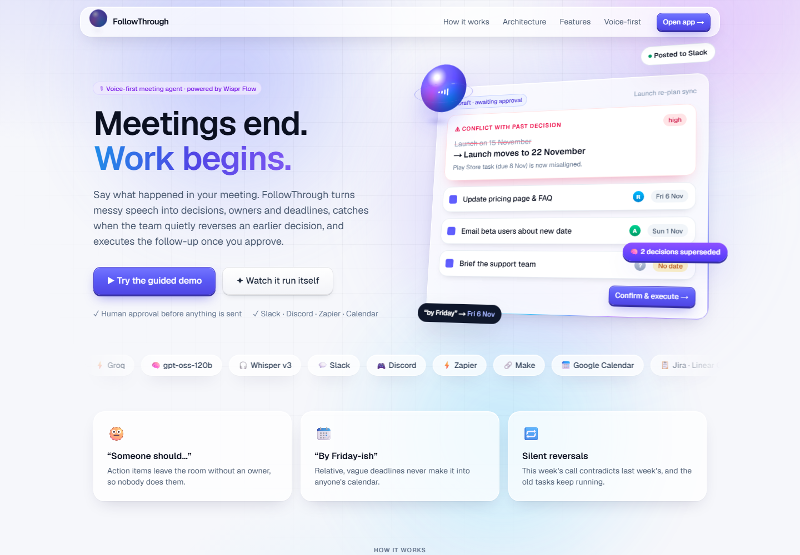

</div>

---

## The problem

Meetings produce decisions and commitments, and most of them evaporate.

| | |
|---|---|
| 🫥 **“Someone should…”** | Action items leave the room without an owner, so nobody does them. |
| 📆 **“By Friday-ish”** | Relative, vague deadlines never reach anyone's calendar. |
| 🔁 **Silent reversals** | This week's call contradicts last week's decision, and the old tasks keep running. |

## The solution

Hold **Caps Lock** (Wispr Flow) and talk through the meeting. FollowThrough turns messy speech into clean, accountable, executed work, with a human approving every step.

**① Capture** → **② Review** → **③ Execute** → **④ Follow up**, with **🧠 Decision Memory** underneath.

---

## Agent workflow

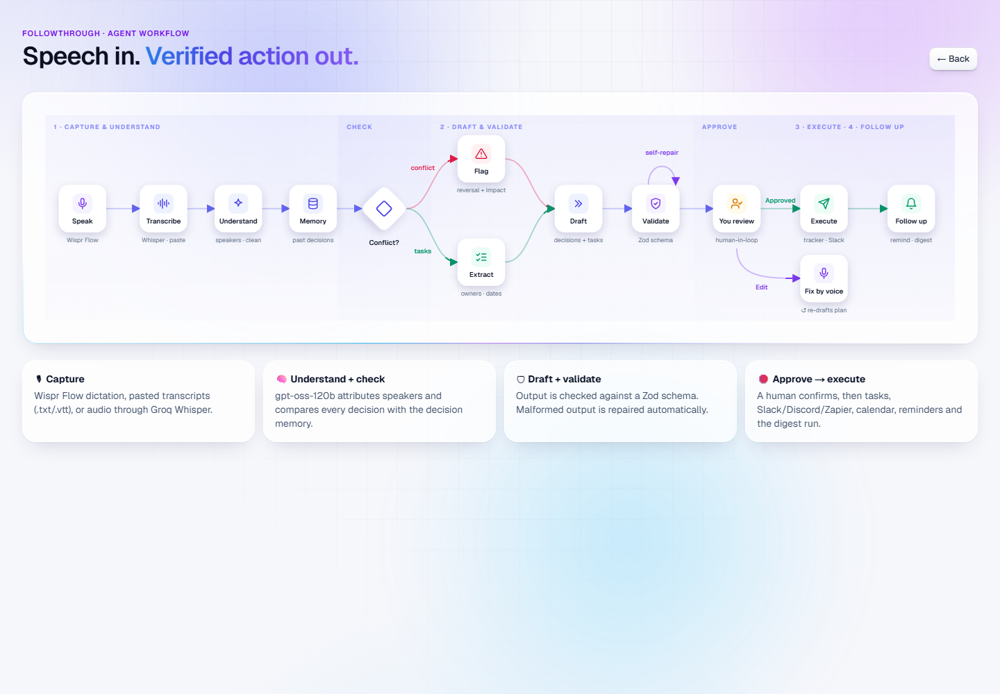

```
Speak (Wispr Flow) → Transcribe (Whisper / paste) → Understand (speakers, clean-up)
  → Memory lookup → Conflict?  ├─ yes → Flag reversal + impact
                                └─ no  → Extract owners · dates
  → Draft → Validate (Zod schema, self-repair loop) → Human review
       ├─ Approved → Execute (tracker · Slack/Discord/Zapier/Make · calendar) → Follow up (reminders · digest)
       └─ Edit     → Fix by voice → re-draft
```

---

## Walkthrough

### 1 · Capture: speak the meeting
Dictate with **Wispr Flow** (hold Caps Lock), paste a transcript (Zoom, Meet, Otter or Wispr Notetaker), drop a `.txt`/`.vtt` file, upload an audio recording (**Groq Whisper**), or use the browser mic.

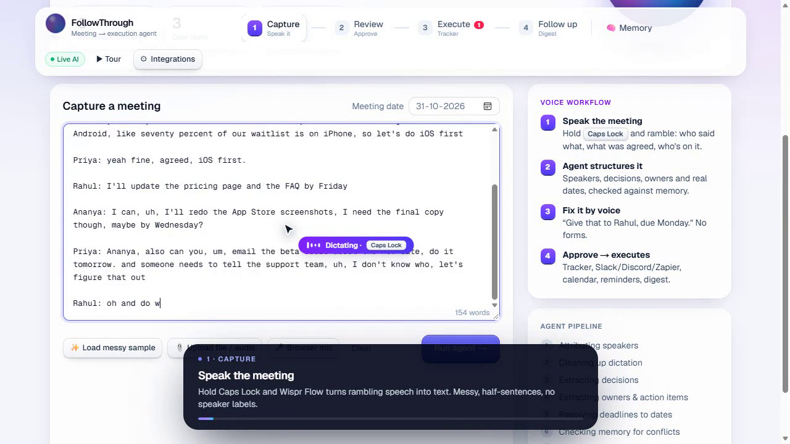

### The agent works, and you can see each step
Speaker attribution → clean-up → decisions → owners and action items → deadline resolution → memory conflict check → draft.

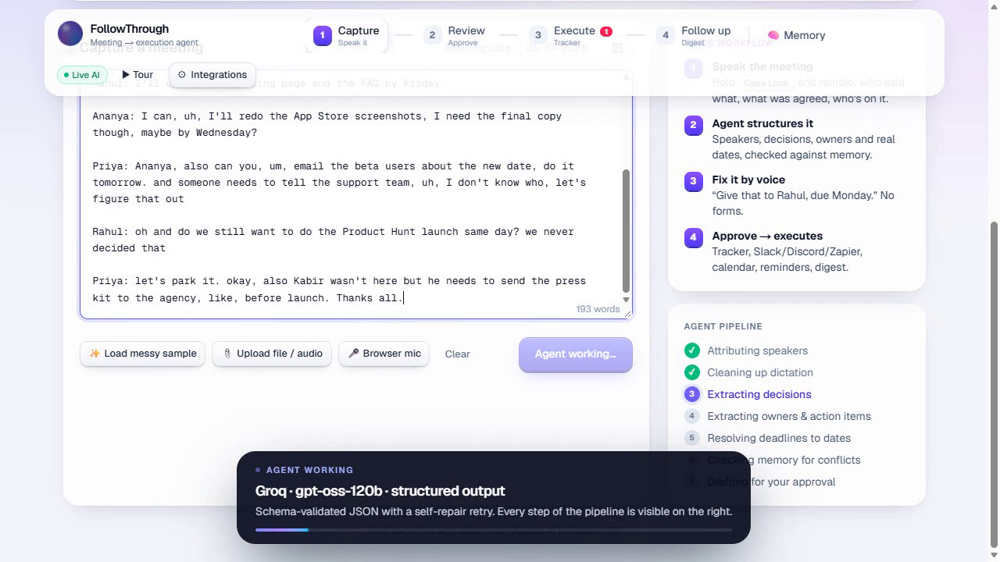

### 2 · Review: a clean, attributed draft
Speakers inferred from unlabeled speech, a summary, and a side-by-side **messy → clean transcript**.

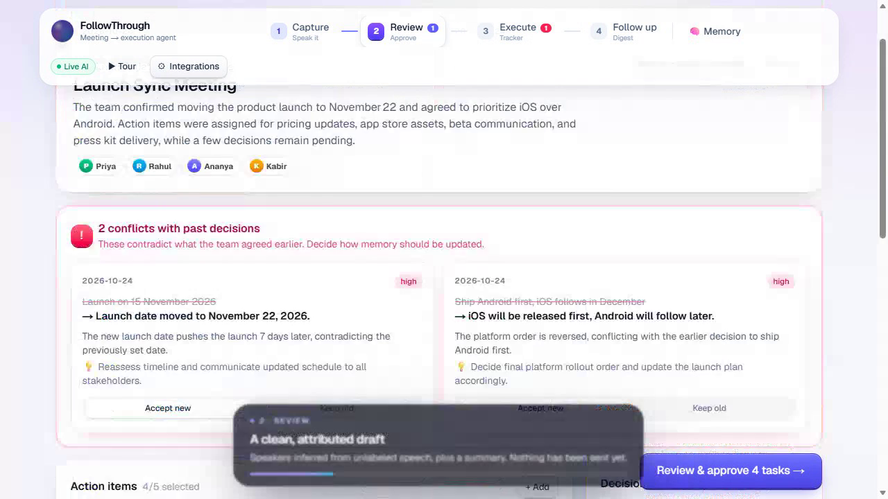

### ⚠ Conflict detection against decision memory
Last week: *launch on 15 Nov, Android first.* This week: *launch moves to 22 Nov, iOS first.* FollowThrough flags both reversals with severity, the impact on open tasks, and a suggested resolution. You choose **Accept new** or **Keep old**.

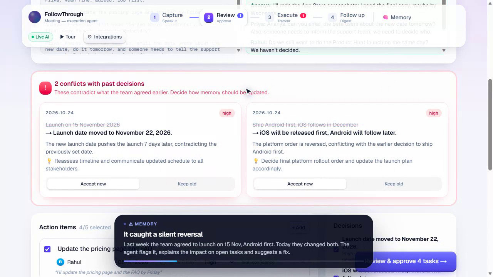

### 🎙 Fix it by voice
*“Give the support team briefing to Kabir, due Monday, and make it high priority.”* The agent rewrites the plan. No forms.

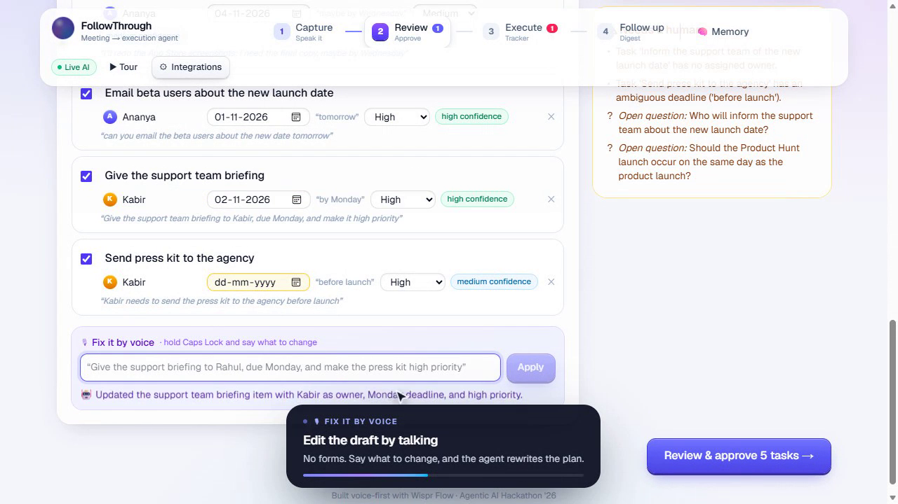

### 🛑 Human-in-the-loop: nothing executes without approval
The confirm dialog shows exactly what will be created, saved to memory, superseded and posted.

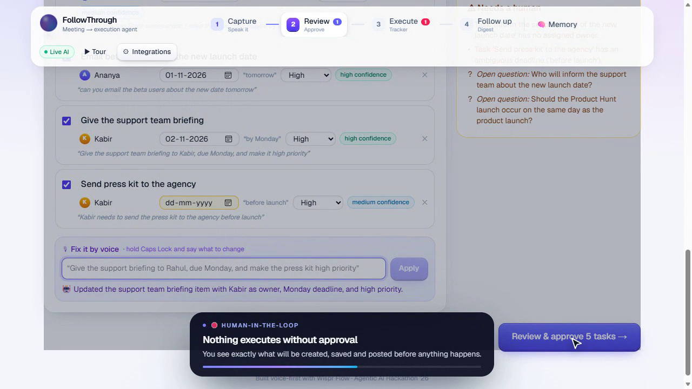

### 3 · Execute: tracker, integrations and reminders
A drag-and-drop Kanban tracker. Recaps post to **Slack, Discord, Zapier or Make**. **.ics** calendar export with alarms, **CSV** for Jira and Linear, and Google Calendar links. Overdue and due-in-48h tasks get **per-owner reminder drafts** that are sent after confirmation.

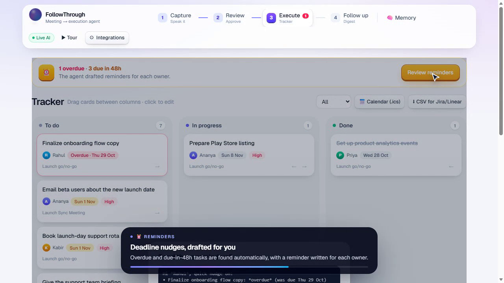

### 📜 Activity log
Every agent, human and integration action is recorded.

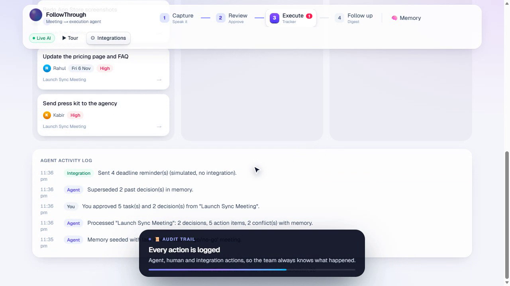

### 🧠 Decision memory
Decisions grouped by topic with full history. Superseded decisions are struck through, so you always know what changed, when, and in which meeting.

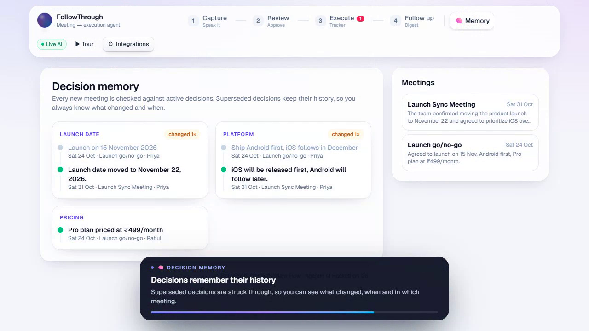

### 4 · Follow up: weekly digest
Highlights, key decisions, overdue, at-risk, load by owner and next-week focus, ready to post.

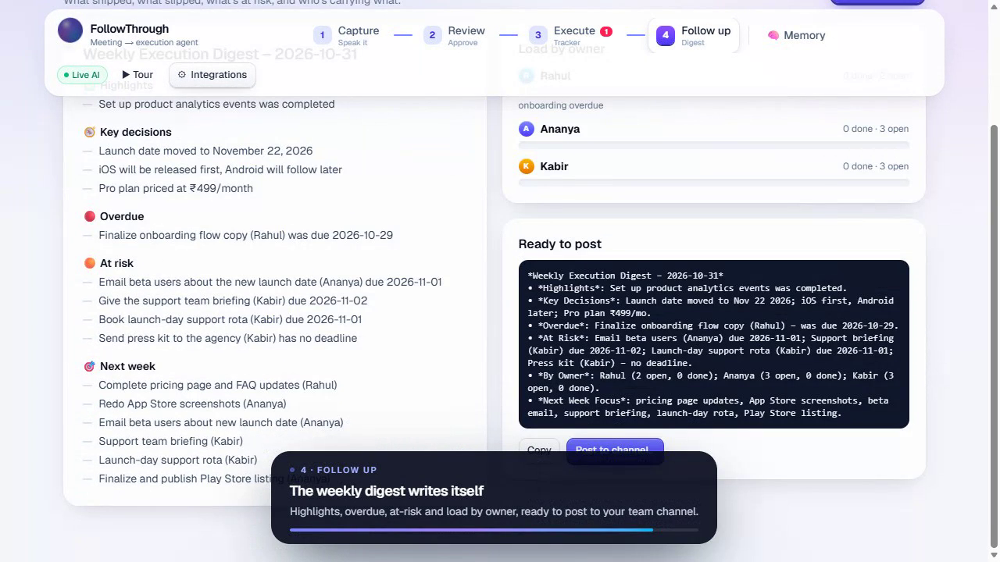

---

## Problem-statement coverage

| Requirement | How FollowThrough does it |
|---|---|
| Ingest transcripts with speaker attribution | Wispr Flow dictation, paste, `.txt`/`.vtt`, audio via Groq Whisper, browser mic. Speakers are inferred even from unlabeled speech. |
| Extract decisions and action items (owners, deadlines) | Structured output: owner, ISO deadline (grounded in an explicit calendar, so “next Wednesday” resolves correctly), priority, confidence, source quote. `Unassigned` is flagged. |
| Detect conflicts with past decisions in memory | Every decision is compared with active memory. Conflicts carry severity, explanation, impact on open tasks and a suggested resolution. Superseded decisions keep their history. |
| Create tracker tasks via an integration | Kanban tracker plus Slack, Discord, Zapier and Make webhooks (structured JSON for Trello, Asana or Jira), `.ics`, CSV, Google Calendar. |
| Send deadline reminders | Overdue and due-soon detection, per-owner nudges, browser notifications. |
| Produce weekly digests | LLM-written digest with load-by-owner bars and a ready-to-post message. |
| Require confirmation before posting | Every external action goes through a preview-and-confirm dialog and is logged. |

## How Wispr Flow is used

1. **As the product's main input.** You dictate the meeting recap and the edit commands. Messy speech goes in, and structured, accountable work comes out.
2. **To build the product.** Specs, prompts, feature requests and fixes were dictated with Wispr Flow into an AI coding agent.

## Tech stack

| Layer | Choice |
|---|---|
| Framework | Next.js 15 (App Router), React 19, TypeScript |
| Styling | Tailwind CSS v4, custom glass / 3D design system, CSS-only 3D voice orb |
| LLM | **Groq** `openai/gpt-oss-120b`: JSON mode, Zod schema in the prompt, validation, automatic self-repair retry |
| Speech-to-text | **Groq Whisper** `whisper-large-v3-turbo` |
| Voice input | **Wispr Flow** (system-wide dictation), Web Speech API fallback |
| Integrations | Slack, Discord, Zapier and Make webhooks (https-only host allowlist, SSRF-safe), `.ics`, CSV |
| Persistence | Browser `localStorage` (meetings, decision memory, tasks, activity log) |
| Hosting | Vercel |

### Project structure
```
app/
  page.tsx              Landing page
  app/page.tsx          The product (4-step workflow)
  flow/page.tsx         Agent workflow diagram
  api/extract           Transcript → decisions, action items, conflicts
  api/command           Voice edits to the draft
  api/digest            Weekly digest
  api/transcribe        Audio → text (Whisper)
  api/push              Slack / Discord / Zapier / Make delivery
  api/status            Live-AI status
components/
  App.tsx               Capture · Review · Tracker · Memory · Digest · Integrations
  Tour.tsx              Self-driving product tour (/app?tour=1)
  FlowDiagram.tsx       Animated SVG agent workflow
  Ambient.tsx           Aurora background + cursor spotlight
lib/
  llm.ts                Groq client, structured output with validation + repair
  prompts.ts            System prompts
  schemas.ts            Zod schemas
  dates.ts              Calendar grounding for relative dates
  store.ts              State, seed data, persistence
  demo.ts               Sample meetings + offline demo output
```

## Run locally

```bash
git clone https://github.com/daanialmirza5/followthrough-agent.git
cd followthrough-agent
npm install
cp .env.example .env.local    # add your GROQ_API_KEY (free at console.groq.com)
npm run dev                   # http://localhost:3000
```

| Variable | Required | Default |
|---|---|---|
| `GROQ_API_KEY` | yes, for live AI | none (demo mode runs the sample meeting only) |
| `GROQ_MODEL` | no | `openai/gpt-oss-120b` |
| `GROQ_WHISPER_MODEL` | no | `whisper-large-v3-turbo` |
| `SLACK_WEBHOOK_URL` | no | none |

## Try it in 60 seconds

1. Open the [**guided demo**](https://followthrough-agent.vercel.app/app?demo=1). The messy sample meeting is pre-loaded.
2. Click **Run agent**. Two red **conflicts** with last week's decisions appear.
3. In *Fix it by voice*, type or dictate: *“give the support briefing to Rahul, due Monday.”*
4. Click **Review & approve**, then **Confirm & execute**. The tasks land in the tracker, and memory shows the old decisions struck through.
5. In the **Tracker**, click **Review reminders**. Then open **Follow up** and click **Generate digest**.

Or just watch the [**auto-play tour**](https://followthrough-agent.vercel.app/app?tour=1).

---

<div align="center">

**FollowThrough.** Speak it, approve it, and nothing falls through.

Built voice-first with Wispr Flow by [Daanial Mirza](https://github.com/daanialmirza5).

</div>
